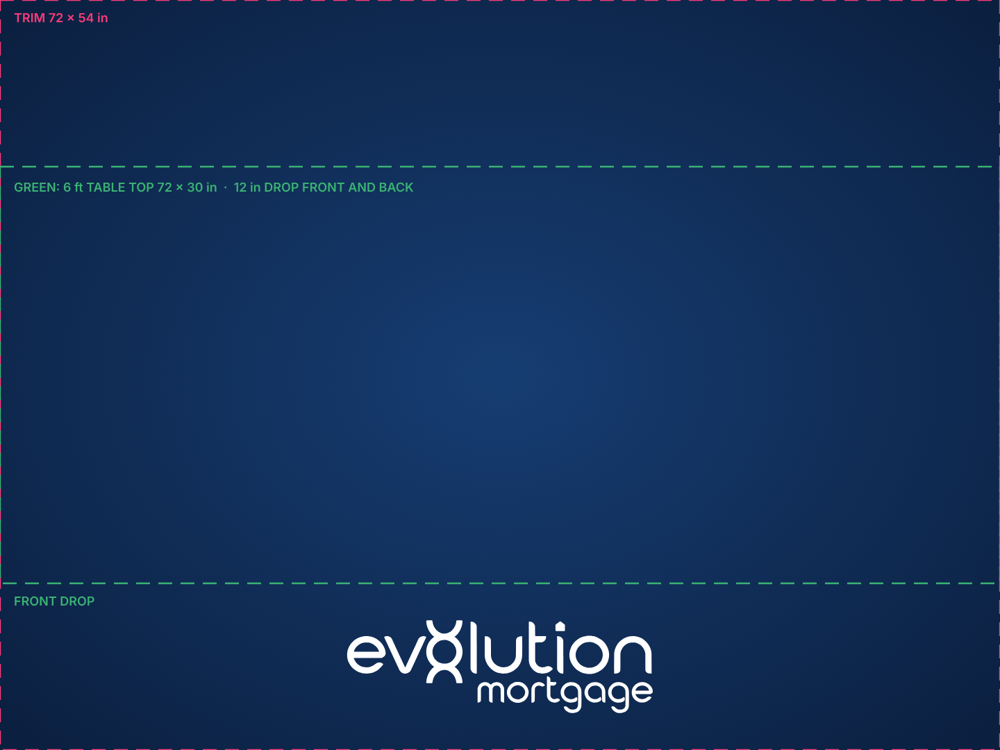

# Evolution Mortgage – navy tablecloth (72 × 54 in)

Flat rectangular tablecloth, 72 × 54 in, navy field with a soft centre glow and the white Evolution Mortgage lockup.
Same navy as the navy tailgate flag: `#0B1F3F` at the edges to `#163D72` at the centre.

## Layout

On a standard 6 ft table (72 × 30 in top) the 54 in width hangs 12 in over the front and the back, with no side drop.
The main file puts the lockup on the **front drop**, 22 in wide, centred in the 12 in band, so it stays visible when the
table top is covered with food and coolers. `alternates/logo-centered/` has the lockup 34 in wide in the middle of the
cloth, for a table that will stay clear or for a different table size.

`alternates/repeat/` is an all-over diamond repeat with **every logo whole**. It has five rows of 11 in lockups, 10.5 in
apart, alternating four and three logos 18 in apart. The nearest logo is 3.5 in from the sides and 4.3 in from the top and bottom.
On a 6 ft table the folds over the table edge fall between rows, and each drop carries one full row.

## Canva

Editable copy with all three layouts as pages (front drop, centered, repeat):
<https://www.canva.com/design/DAHZQAaUtDY/edit>

- Each page is a navy background image plus separate white logo elements, so any logo can be moved, resized or deleted.
- Pages are 4608 × 3456 px, which is 72 × 54 in at 64 px per inch. Canva caps page size, so it can't hold 96 px per inch at this size.
- To print from Canva, use Share, then Download, then PDF Print. Tell the printer the finished size is 72 × 54 in and that the file has no bleed. The PRINT-bleed PDFs here remain the reference print files.
- Sources are in `canva-layers/`: the background, the logo layer and the import file.

## Ordering notes

- Ask for dye-sublimated polyester (twill or poplin), hemmed on all four sides. It is machine washable and wrinkle resistant.
- Confirm the printer's hem allowance. If their template is a different size, the layout regenerates in seconds.
- Regenerate with `python3 source/make_tablecloth.py` next to the flag generator (`../evolution-mortgage-tailgate-flag/source/make_flag.py`).
